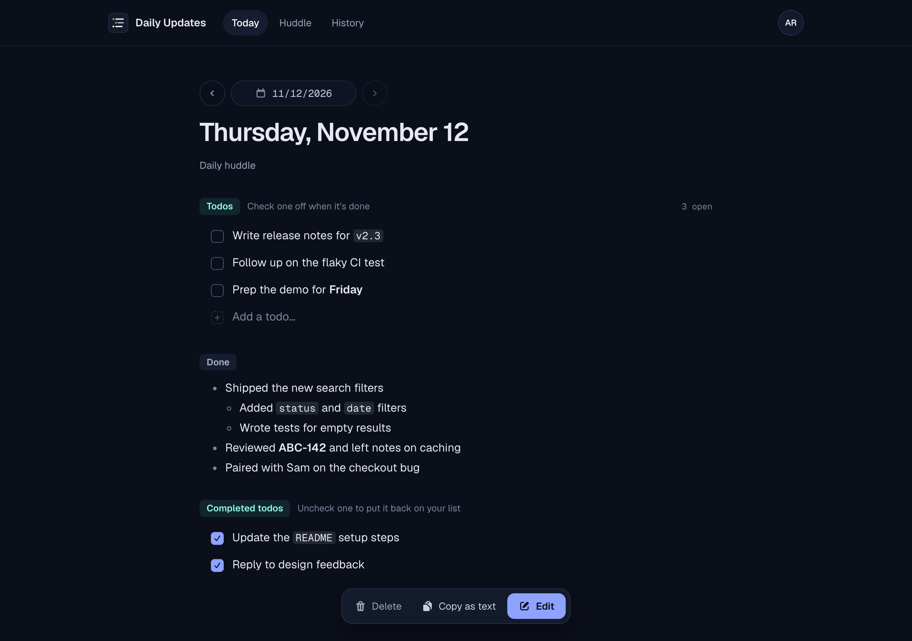

# Daily Updates

A small app for keeping a log of your workday and sharing it at the next morning's huddle.

Write down what you get done as the day goes, keep a running todo list at the top of it, and the next morning open the **Huddle** page to see (and copy) yesterday's log, ready to read out or paste into chat.



## Features

- **A log for each workday.** Each day has a **Done** section with a rich text editor. Markdown shortcuts work as you type (`` `code` ``, `**bold**`, `- ` for a bullet), and everything saves automatically a couple of seconds after you stop typing.
- **Todos.** One running list at the top of today's log. Check a todo off and it shows up under **Completed todos** for that day. Click a todo to edit it, and use inline Markdown in todos too.
- **Huddle.** Shows the most recent workday's log under *Yesterday*, along with the todos completed that day, with a **Copy for huddle** button that produces plain text.
- **History.** Every past log, newest first, with search and highlighted matches.
- **Copy as text.** Any day's log can be copied as plain-text bullets.

## Requirements

- PHP 8.3 or newer, with the SQLite extension
- [Composer](https://getcomposer.org)
- [Node.js](https://nodejs.org) and npm

Data is stored in a local SQLite database, so there's no database server to set up.

## Getting started

```bash
git clone https://github.com/christiaanschmid/daily-updates.git
cd daily-updates
composer setup
```

`composer setup` installs the PHP and JavaScript dependencies, creates your `.env` file, generates an app key, creates the SQLite database, and builds the front-end assets.

Then set your timezone in `.env`, so "today" changes over at your own midnight:

```dotenv
APP_TIMEZONE=America/Phoenix
```

Start the app:

```bash
composer run dev
```

Open the URL it prints (by default http://localhost:8000), register an account, and start logging. If you use [Laravel Herd](https://herd.laravel.com), the app is served at `http://daily-updates.test` without running a server yourself; run `npm run dev` for live asset reloading, or `npm run build` once.

## Running the tests

```bash
php artisan test
```

## Built with

[Laravel](https://laravel.com), [Livewire](https://livewire.laravel.com), [Flux](https://fluxui.dev) (free edition), [Tiptap](https://tiptap.dev) and [Tailwind CSS](https://tailwindcss.com).

## License

Daily Updates is open source software released under the [MIT license](LICENSE).
