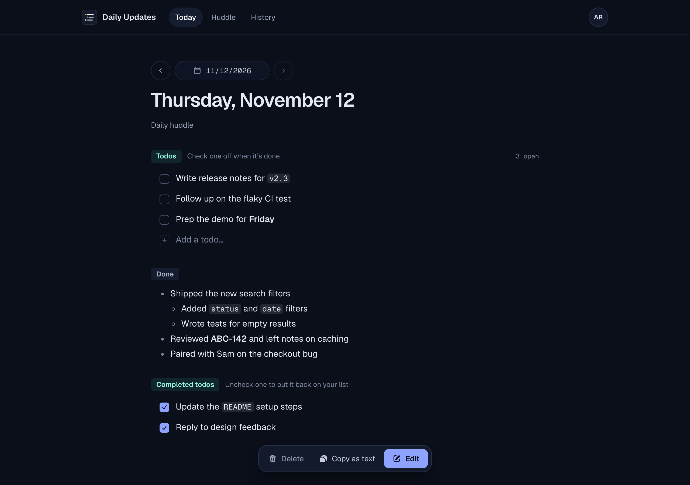

# Daily Updates

A small app for keeping a log of your workday and sharing it at the next morning's huddle.

Write down what you get done as the day goes, keep a running todo list at the top of it, and the next morning open the **Huddle** page to see (and copy) yesterday's log, ready to read out or paste into chat.



## Features

- **A log for each workday.** Each day has a **Done** section with a rich text editor. Markdown shortcuts work as you type (`` `code` ``, `**bold**`, `- ` for a bullet), and everything saves automatically a couple of seconds after you stop typing.
- **Todos.** One running list at the top of today's log. Check a todo off and it shows up under **Completed todos** for that day. Click a todo to edit it, and use inline Markdown in todos too.
- **Huddle.** Shows the most recent workday's log under *Yesterday*, along with the todos completed that day, with a **Copy for huddle** button that produces plain text.
- **History.** Every past log, newest first, with search and highlighted matches.
- **Copy as text.** Any day's log can be copied as plain-text bullets.

## Requirements

- PHP 8.3 or newer, with the SQLite extension
- [Composer](https://getcomposer.org)
- [Node.js](https://nodejs.org) and npm

Data is stored in a local SQLite database, so there's no database server to set up.

The [desktop app](#desktop-app) also needs macOS 12 or newer and Node.js 22 or newer.

## Getting started

```bash
git clone https://github.com/christiaanschmid/daily-updates.git
cd daily-updates
composer setup
```

`composer setup` installs the PHP and JavaScript dependencies, creates your `.env` file, generates an app key, creates the SQLite database, and builds the front-end assets.

Then set your timezone in `.env`, so "today" changes over at your own midnight:

```dotenv
APP_TIMEZONE=America/Phoenix
```

Start the app:

```bash
composer run dev
```

Open the URL it prints (by default http://localhost:8000), register an account, and start logging. If you use [Laravel Herd](https://herd.laravel.com), the app is served at `http://daily-updates.test` without running a server yourself; run `npm run dev` for live asset reloading, or `npm run build` once.

## Hosting on Laravel Cloud

The web version can be hosted on [Laravel Cloud](https://cloud.laravel.com) with a MySQL database, so your logs are available from any device. SQLite doesn't work there, because Laravel Cloud resets the app's files on every deploy. The app also works with Postgres.

1. **Create the app.** In Laravel Cloud, create an application from this GitHub repository and choose a region.
2. **Add a database.** On the environment's canvas, click **Add database** and create a **Laravel MySQL** database in the same region. Laravel Cloud fills in the `DB_*` settings for you.
3. **Set the build commands** (Settings → Deployments):

   ```bash
   composer install --no-dev
   npm ci --audit false
   npm run build
   php artisan optimize
   ```

4. **Set the deploy command:**

   ```bash
   php artisan migrate --force
   ```

5. **Add email.** Registering sends a verification email. Click **Add resource → Emails** and connect a [Resend](https://resend.com) account. Laravel Cloud fills in `MAIL_MAILER`, `RESEND_API_KEY` and the sender address. Resend asks you to verify a sending domain with DNS records; Laravel Cloud suggests a subdomain such as `notifications.example.com`.
6. **Set the environment variables** that aren't filled in for you:

   ```dotenv
   APP_NAME="Daily Updates"
   APP_TIMEZONE=America/Phoenix
   CACHE_STORE=database
   SESSION_DRIVER=database
   ```

   `APP_TIMEZONE` is only the default. Each account's timezone is picked up from the browser when they register, and can be changed in **Settings → Profile**.
7. **Deploy.** Laravel Cloud deploys again whenever you push to the environment's branch.

### Free and cloud plans

On the web, a free account sees and writes logs for its last 14 days. Older logs are kept, and show again on the cloud plan, which has the full history. The desktop app has no limit, because everything stays on your Mac.

People subscribe under **Settings → Plan**, for $5 a month or $50 a year with a 30-day free trial. Payments go through [Paddle](https://www.paddle.com), using [Laravel Cashier Paddle](https://laravel.com/docs/cashier-paddle). Canceling keeps the cloud plan until the end of the trial or the period already paid for. If a payment fails, the account works like the free plan until the payment method is updated.

You can also give an account the cloud plan without a subscription, for example your own. In Laravel Cloud, go to the environment's **Commands** tab, click **Open console** and run:

```bash
php artisan cloud-plan:grant someone@example.com
```

Add `--revoke` to take it away again.

### Setting up Paddle

Do this in your Paddle sandbox first, then again in your live account. They're separate, with their own keys, prices and settings.

1. **Product and prices.** Under **Catalog → Products**, create one product with two prices: $5.00 a month and $50.00 a year, each with a 30-day free trial. The trial is set on the price, so it's Paddle, not this app, that decides when people are charged. If you change its length, change `trial_days` in `config/services.php` too, which is only the text on the Plan page.
2. **Default payment link.** Under **Checkout → Checkout configuration**, set the default payment link to `https://your-domain/pay`. Paddle won't open any checkout until this is set, and it sends people there to update their payment method.
3. **Webhooks.** Under **Events → Notifications**, add a destination for `https://your-domain/paddle/webhook` with these events: `customer.updated`, `transaction.completed`, `transaction.updated`, `subscription.created`, `subscription.updated`, `subscription.paused` and `subscription.canceled`. Copy its secret key into `PADDLE_WEBHOOK_SECRET`. Without a secret, the app refuses every webhook, because it can't tell Paddle's apart from forged ones.
4. **Environment variables** (in Laravel Cloud, or `.env` locally): `PADDLE_SANDBOX`, `PADDLE_CLIENT_SIDE_TOKEN`, `PADDLE_API_KEY`, `PADDLE_WEBHOOK_SECRET`, `PADDLE_PRICE_MONTHLY` and `PADDLE_PRICE_YEARLY`. `.env.example` says where each one comes from. Set `PADDLE_SANDBOX=false` only with your live account's values.

The app has no queued jobs or scheduled tasks, so it doesn't need a queue worker or the scheduler. The desktop app isn't affected by any of this: it always uses its own SQLite database on your Mac.

## Desktop app

Daily Updates also runs as a Mac app, built with [NativePHP](https://nativephp.com/docs/desktop). It's the same app in its own window, with no server to run and no login: it signs you in automatically as its one local user.

### Installing the app

After `composer setup`, build the app and install it in `/Applications`:

```bash
composer desktop:install
```

The first build downloads a lot and takes several minutes. When it's done, Daily Updates opens, and from then on you can open it like any other app, without running anything here.

To get later changes into the installed app, for example after a `git pull`, run `composer desktop:install` again. It builds whatever is in this folder, including changes you haven't committed, quits the installed copy if it's open, replaces it and opens the new one.

Each build gets a new version made from the date and time, such as `2026.11.121105`. The app runs any new database migrations when its version changes, so you never need to set the version yourself. Your data lives in `~/Library/Application Support/daily-updates/`, outside the app, so it's kept when the app is replaced.

The app has no automatic updates: NativePHP's updater is turned off in `config/nativephp.php`, because it needs a signed app published somewhere to update from.

### Developing with the desktop app

To work on the app in its desktop window, run these once after `composer setup`:

```bash
php artisan native:install --no-interaction
```

```bash
node vendor/nativephp/desktop/resources/electron/node_modules/electron/install.js
```

```bash
php artisan native:migrate
```

The first installs NativePHP's Electron shell and a PHP binary for the app. The second downloads Electron itself: NativePHP looks for Electron before starting it, and Electron 45 no longer downloads itself when installed, so this step is needed on every fresh clone. The third creates the development database.

Then start the app:

```bash
composer native:dev
```

This opens the app in its own window and runs Vite, so front-end changes reload as you work. Changes to PHP code need a restart: press `Ctrl+C` and run it again.

### Where your data is stored

The desktop app keeps its data apart from the browser version:

- **The installed app:** `~/Library/Application Support/daily-updates/database/database.sqlite`
- **While developing:** `database/nativephp.sqlite`

### Building the app

To build without installing:

```bash
php artisan native:build mac arm64
```

Use `x64` instead of `arm64` for Intel Macs. The build runs `npm run build` first, then writes `Daily Updates.app`, a `.dmg` and a `.zip` to `nativephp/electron/dist/`.

The build is not code signed, so it opens on the Mac that built it, but other Macs will say the app is damaged. The easiest way to share it is to have the other person clone this repository and run `composer desktop:install` on their own Mac. To share a build directly, you need an [Apple Developer Program](https://developer.apple.com/programs/) membership and these settings in `.env` when you build: `NATIVEPHP_APPLE_ID`, `NATIVEPHP_APPLE_ID_PASS` (an app-specific password) and `NATIVEPHP_APPLE_TEAM_ID`. See NativePHP's [building guide](https://nativephp.com/docs/desktop/2/publishing/building).

Your `.env` file is copied into the app, where anyone who has it can read it, so keep secrets out of it. NativePHP removes a few known keys, listed under `cleanup_env_keys` in `config/nativephp.php`.

### App icon

The app icon is the web icon fitted to the size macOS expects. Its source is `resources/icons/desktop-icon.svg`. After changing it, regenerate `public/icon.png` and `public/icon.icns` with:

```bash
resources/icons/render-desktop-icon.sh
```

## Running the tests

```bash
php artisan test
```

## Built with

[Laravel](https://laravel.com), [Livewire](https://livewire.laravel.com), [Flux](https://fluxui.dev) (free edition), [Tiptap](https://tiptap.dev) and [Tailwind CSS](https://tailwindcss.com).

## License

Daily Updates is open source software released under the [MIT license](LICENSE).
